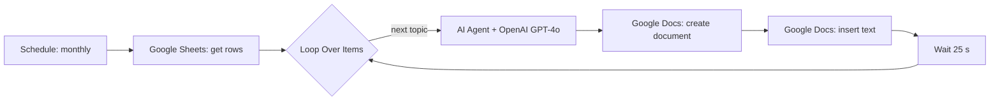

# Topic Queue to Google Docs (n8n AI Agent)

Scheduled n8n workflow that takes article topics from Google Sheets, writes an article for each topic with an AI Agent on GPT-4o, and creates a separate Google Doc for every article.

[Описание на русском](#на-русском)

## How it works

- Runs on a monthly schedule. Topics come from the `topic` column of the sheet.
- The system prompt asks for a long-form gambling article:
  - at least 2,500–3,000 characters;
  - title and section headings in uppercase;
  - no Markdown or special symbols, normal paragraphs;
  - the client brand mentioned once, only in the first paragraph.
- Each article goes into a new Google Doc named after its topic. A 25-second pause between topics spaces out API calls.

## Setup

1. Import `4_Ai_french_article.sanitized.json` into n8n.
2. Connect OpenAI, Google Sheets and Google Docs credentials.
3. Point **Get row(s) in sheet** at your sheet with a `topic` column and set the folder ID in **Create a document**.
4. Replace `{{CLIENT_BRAND}}` in the AI Agent system message with the brand name.

## Status

The request to the model is written in French, while the system message requires English, so articles currently come out in English. Planned: a `language` column in the sheet, passed into the system message.

## Stack

n8n · AI Agent node (LangChain) · OpenAI GPT-4o · Google Sheets API · Google Docs API

## На русском

n8n-воркфлоу по расписанию: раз в месяц берёт темы из Google Sheets, по каждой пишет статью через AI Agent на GPT-4o и создаёт отдельный Google Doc с названием темы. В системном промпте заданы объём от 2 500 знаков, заголовки заглавными буквами, текст без markdown и одно упоминание бренда в первом абзаце.

Сейчас запрос к модели на французском, а системный промпт требует английский, поэтому статьи выходят на английском. План: колонка `language` в таблице.
